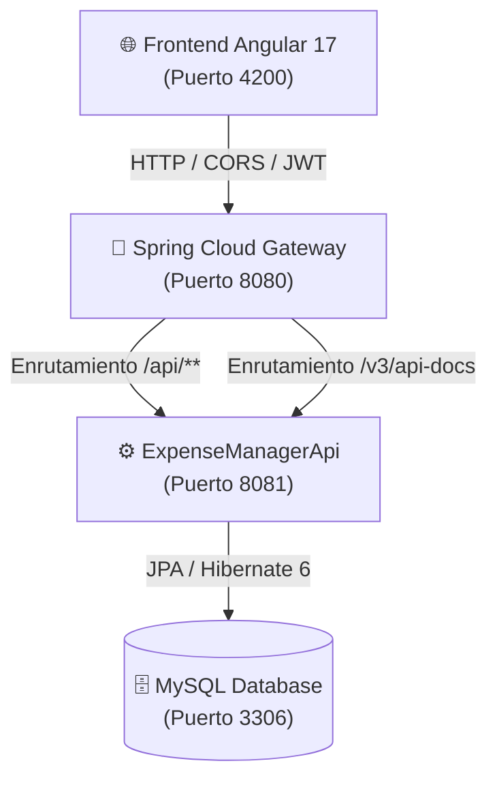

# ⚡ ExpenseFlow — DDD FinTech & Expense Manager

Plataforma integral de gestión de finanzas personales y empresariales construida bajo los principios de **Domain-Driven Design (DDD)**, arquitectura distribuida con **Spring Cloud Gateway**, **Spring Boot 3** y un cliente web reactivo en **Angular 17 Standalone**.

---

## 🏗️ Arquitectura de la Solución



### 1. Módulos Backend (Maven Multi-Module)
* [ExpenseManagerSharedKernel](file:///Users/garyfranco/Desktop/TECNOLOGIAS/SPRING%20BOOT/spring-boot-expense-manager-ddd/ExpenseManagerSharedKernel): Núcleo compartido con Value Objects (`Money`, `UserEmailValue`, `AccountName`, `DateRange`), Business Rules (`GreaterThanZeroRule`, `NonNegativeAmountRule`, `NotEqualRule`, `StringNotNullOrEmptyRule`) y excepciones de dominio.
* [ExpenseManagerDomain](file:///Users/garyfranco/Desktop/TECNOLOGIAS/SPRING%20BOOT/spring-boot-expense-manager-ddd/ExpenseManagerDomain): Modelo rico con Agregados (`Account`, `Transaction`, `Transfer`, `User`, `Category`), eventos de dominio puros y contratos de repositorio.
* [ExpenseManagerApplication](file:///Users/garyfranco/Desktop/TECNOLOGIAS/SPRING%20BOOT/spring-boot-expense-manager-ddd/ExpenseManagerApplication): Casos de uso implementados con patrón CQRS (PipelinR), transaccionalidad atómica (`@Transactional`) y desacoplamiento con despachador de eventos.
* [ExpenseManagerInfrastructure](file:///Users/garyfranco/Desktop/TECNOLOGIAS/SPRING%20BOOT/spring-boot-expense-manager-ddd/ExpenseManagerInfrastructure): Implementaciones JPA, Spring Security 6, JWT Bearer y servicios criptográficos.
* [ExpenseManagerApi](file:///Users/garyfranco/Desktop/TECNOLOGIAS/SPRING%20BOOT/spring-boot-expense-manager-ddd/ExpenseManagerApi): Controladores REST, OpenAPI / Swagger UI y Manejador Global de Excepciones (`@RestControllerAdvice`). Ejecuta en el **puerto 8081**.
* [ExpenseManagerGateway](file:///Users/garyfranco/Desktop/TECNOLOGIAS/SPRING%20BOOT/spring-boot-expense-manager-ddd/ExpenseManagerGateway): API Gateway reactivo con Spring Cloud Gateway. Centraliza el enrutamiento, CORS global y métricas Actuator. Ejecuta en el **puerto 8080**.

### 2. Frontend Web (Angular 17 Standalone)
* [expense-manager-frontend](file:///Users/garyfranco/Desktop/TECNOLOGIAS/SPRING%20BOOT/spring-boot-expense-manager-ddd/expense-manager-frontend):
  - **Componentes Standalone**: Sin módulos `NgModule` pesados.
  - **Angular Signals & Computeds**: Gestión de estado reactivo y ligero.
  - **Interceptor JWT (`authInterceptor`)**: Inyección automática de tokens Bearer a peticiones hacia el Gateway.
  - **Guard de Navegación (`authGuard`)**: Protección de rutas privadas.
  - **Diseño FinTech Luxury Dark**: Glassmorphism, paleta HSL seleccionada, animaciones suaves y micro-interacciones.

---

## 🚀 Guía de Ejecución

### 1. Requisitos Previos
* **Java 17** (Amazon Corretto, OpenJDK o Temurin)
* **Node.js 20+** y **npm 10+**
* **MySQL 8** (Base de datos: `db_expense_manager`)

### 2. Compilar Todo el Backend
```bash
export JAVA_HOME=$(/usr/libexec/java_home -v 17.0.18) # En macOS
mvn clean test
```

### 3. Iniciar el Backend (2 Servicios)
1. **Iniciar la API de Negocio (Puerto 8081)**:
   ```bash
   mvn spring-boot:run -pl ExpenseManagerApi
   ```
2. **Iniciar el API Gateway (Puerto 8080)**:
   ```bash
   mvn spring-boot:run -pl ExpenseManagerGateway
   ```

### 4. Iniciar el Frontend en Angular (Puerto 4200)
```bash
cd expense-manager-frontend
npm start
```
Abre en tu navegador: [http://localhost:4200](http://localhost:4200).

---

## 🔐 Credenciales y Prueba Rápida
* La pantalla de login incluye un botón **"⚡ Usar credenciales de prueba"** o puedes registrar un nuevo usuario en `/register`.
* Swagger UI disponible a través del Gateway: [http://localhost:8080/swagger-ui.html](http://localhost:8080/swagger-ui.html).
